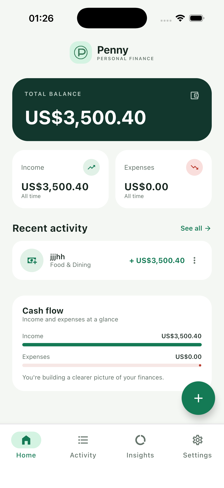
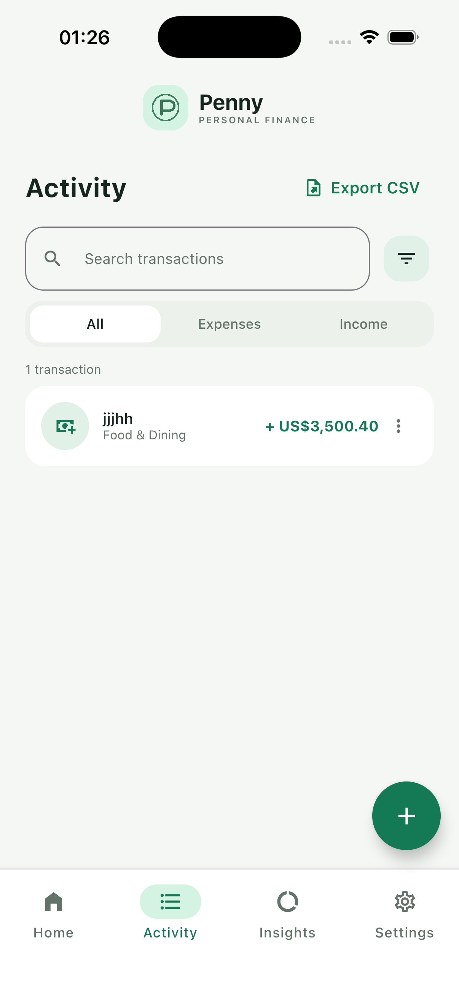
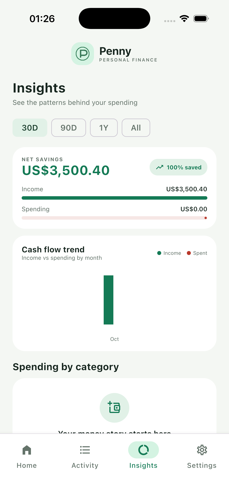
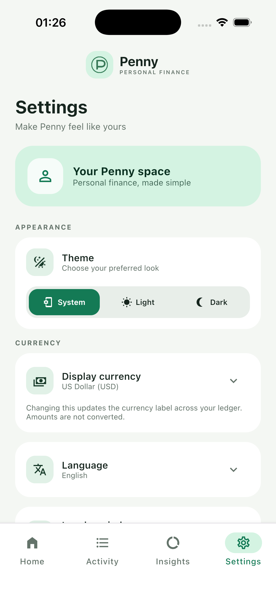
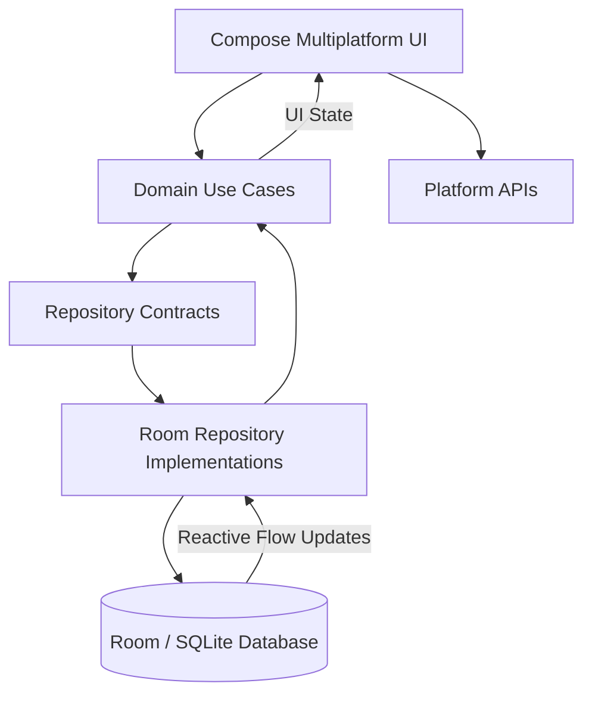

# Penny

**A privacy-focused, offline-first personal finance app for Android and iOS, built with Kotlin Multiplatform and Compose Multiplatform.**

Penny helps users track income, expenses, budgets, and recurring transactions without creating an account or relying on a server. All financial data stays on the device, persisted in a Room database that serves as the single source of truth.

## Screenshots

<p align="center">
  
  
  
  
</p>

## Features

### Personal Finance
- Track income and expenses with input validation.
- View balances, income, expenses, recent activity, and cash-flow summaries.
- Search transactions and filter by type or category.
- Analyze spending by category.
- Create monthly category budgets with progress tracking, overspending calculations, and cash-flow insights.
- Schedule weekly and monthly recurring transactions.
- Review upcoming transactions on a dedicated Scheduled screen.
- Save activity filters and review transaction edit history.
- Edit transactions or delete them with confirmation.

### Privacy & Data Management
- Fully local data storage with Room and SQLite.
- No backend, user accounts, cloud synchronization, or internet dependency.
- Encrypted full-data backups and file-based restoration.
- Passphrase-based backup encryption using PBKDF2-HMAC-SHA256 and authenticated AES-GCM.
- Transactional restore of backed-up data, including recurring transaction rules.
- CSV export through the native platform share sheet.
- Optional local reminders for recurring transactions and budget limits.
- Device-authenticated app lock.

### Personalization & Accessibility
- System, light, and dark themes.
- Selectable display currencies: USD, EUR, GBP, CAD, and AUD.
- Eight UI languages: English, Persian, Arabic, Spanish, French, Simplified Chinese, Japanese, and Korean.
- Right-to-left layouts for Persian and Arabic.

### Engineering
- Kotlin Multiplatform and Compose Multiplatform UI.
- Shared business logic and persistence across Android and iOS.
- Room Multiplatform with bundled SQLite.
- Clean separation between domain use cases, repository contracts, and data implementations.
- Koin dependency injection.
- Kotlin serialization-ready transaction models.
- Common tests for financial calculations, validation, CSV formatting, and encrypted backup integrity.
- Room schema migrations for budgets, preferences, and recurring transaction rules.

## Architecture

Penny uses a local-first architecture. The Room database is the source of truth, and reactive data flows keep the UI synchronized with persisted records.



The shared module contains the domain rules, repository contracts, Room persistence, dependency injection, and presentation logic. Platform-specific implementations handle operating-system capabilities such as database paths, file selection, sharing, authentication, and notification scheduling.

### Project Structure

```text
shared/src/commonMain/
├── data/
│   ├── local/database/   # Room entities, DAO, and database
│   └── repository/       # Room-backed repository implementations
├── di/                   # Koin dependency injection
├── domain/
│   ├── model/            # Finance domain models
│   ├── repository/       # Repository contracts
│   └── usecase/          # Finance rules and calculations
└── presentation/         # UI state and Compose screens
```

Android stores `penny.db` in its app database directory. iOS stores the database in Application Support. Both platforms share the same Room schema, DAO, repository implementations, and business logic.

## Tech Stack

| Area | Technologies |
|---|---|
| Language | Kotlin |
| Cross-platform | Kotlin Multiplatform (KMP) |
| UI | Compose Multiplatform |
| Local database | Room Multiplatform, SQLite |
| Reactive state | Kotlin Flow, StateFlow |
| Dependency injection | Koin |
| Serialization | Kotlin serialization |
| Testing | Kotlin Multiplatform common tests |
| Platform integration | Android and iOS APIs |

## Getting Started

### Android

Build a debug APK:

```bash
./gradlew :androidApp:assembleDebug
```

Compile the Android Kotlin source:

```bash
./gradlew :androidApp:compileDebugKotlin
```

### iOS

Open `iosApp/iosApp.xcodeproj` in Xcode and run the `iosApp` scheme.

To compile the shared module for an Apple Silicon iOS simulator:

```bash
./gradlew :shared:compileKotlinIosSimulatorArm64
```

### Tests

Run the shared module's multiplatform tests:

```bash
./gradlew :shared:allTests
```

## Design & Security Notes

- **Exact financial arithmetic:** Monetary amounts are stored as integer minor units, such as cents, avoiding floating-point rounding errors in financial totals.
- **Display currency:** Changing the selected currency changes its display label only. Penny does not perform foreign-exchange conversion.
- **Local-first experience:** A new installation starts with an empty dashboard. Add a transaction to populate it.
- **Encrypted backups:** Each backup uses a random salt, PBKDF2-HMAC-SHA256 key derivation, and authenticated AES-GCM encryption. The app does not store the backup passphrase; a forgotten passphrase cannot be recovered.
- **Safe restoration:** Backup validation occurs before the backed-up Room tables are replaced in a database transaction.
- **Local notifications:** Reminder scheduling is handled on-device and requires the relevant operating-system notification permission.
- **Localization consistency:** Translation resources are maintained under `shared/src/commonMain/composeResources/values*/strings.xml`.

Check that the eight localization catalogs remain aligned:

```bash
python3 scripts/check_localized_resources.py
```

## Privacy

Penny does not require an account, use a backend, or synchronize financial records to the cloud. Financial data is stored locally on the device.

---

*Built as a Kotlin Multiplatform portfolio project, with an emphasis on offline-first architecture, data privacy, shared business logic, and maintainable application design.*
