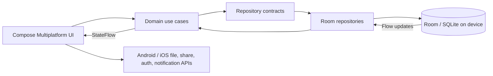

# Penny

Penny is an offline-first personal finance app for Android and iOS, built with Kotlin Multiplatform and Compose Multiplatform. Financial records live on the device in a Room database. The database is the source of truth; screens react to its flows, and there is no backend, account, or network dependency.


## Screenshots

<p align="center">
  
  
  
  
</p>

## What’s here

- Shared Compose dashboard for Android and iOS
- Local income and expense entry with input validation
- Room Multiplatform persistence backed by bundled SQLite
- Reactive balance, income, expenses, recent activity, and cash-flow summary
- Search, transaction-type and category filters over the full local history
- Category-level spending breakdown
- System, light, and dark appearance preferences, saved in Room
- Selectable display currency (USD, EUR, GBP, CAD, AUD), saved in Room
- English, Persian, Arabic, Spanish, French, Simplified Chinese, Japanese, and Korean UI preferences; Persian and Arabic use right-to-left layout
- CSV export through the platform share sheet, with a generated export file
- Passphrase-protected, encrypted full-data backup and file-based restore
- Optional on-device reminders for upcoming recurring transactions and category budgets nearing their limits
- Weekly and monthly recurring transactions, managed on a dedicated Scheduled screen
- Monthly category budgets with progress, over-limit calculations, and cash-flow insights
- Saved activity filters, transaction edit history, and device-authenticated app lock
- Edit and delete actions for transactions, with a confirmation before deletion
- Domain use cases and repository boundary
- Koin dependency wiring
- Kotlin serialization-ready transaction models
- Common tests for finance calculations, validation, CSV formatting, and encrypted backup integrity
- Room schema migrations for budgets, preferences, and recurring transaction rules

## Architecture



The same domain rules and persistence code are shared across both platforms. Platform adapters only handle operating-system capabilities.

```text
shared/src/commonMain/
├── data/
│   ├── local/database/   Room entities, DAO, database
│   └── repository/       Room-backed repository implementation
├── di/                   Koin module
├── domain/
│   ├── model/            Finance models
│   ├── repository/       Repository contract
│   └── usecase/          Dashboard calculation and transaction rules
└── presentation/         StateFlow-backed dashboard state and Compose UI
```

Platform-specific code is limited to device capabilities such as database paths, file pickers, sharing, authentication, and local notification scheduling. Android stores `penny.db` in its app database directory; iOS stores it in Application Support. Both use the same Room schema, DAO, repositories, and business logic. Room remains the source of truth; there is no backend or sync service.

## Run

- Android: `./gradlew :androidApp:assembleDebug`
- iOS: open `iosApp/iosApp.xcodeproj` in Xcode and run the `iosApp` scheme.
- Common tests: `./gradlew :shared:allTests`
- Android compile check: `./gradlew :androidApp:compileDebugKotlin`
- iOS simulator compile check: `./gradlew :shared:compileKotlinIosSimulatorArm64`

## Design notes

Amounts are represented as integer minor units (for example, cents) to avoid floating-point arithmetic in financial totals. The selected currency changes the display label and does not perform exchange conversion. The starter experience is intentionally empty; add a transaction to populate the dashboard.

Encrypted backups use a random salt, PBKDF2-HMAC-SHA256 key derivation, and authenticated AES-GCM encryption. Restore validates the backup and replaces its Room tables in one transaction, including recurring rules. The backup passphrase is not stored by the app and cannot be recovered if forgotten. Recurring transaction and budget reminders are scheduled locally and require the operating system’s notification permission.

Penny does not request internet access and does not send financial data off-device.

Locale resource catalogs are under shared/src/commonMain/composeResources/values*/strings.xml. Run python3 scripts/check_localized_resources.py to verify that the resource names remain aligned across the eight catalogs.

## Portfolio screenshots

For a portfolio presentation, capture the Home dashboard, Activity filters, Insights budgets, Settings, transaction editor, and Backup & restore. Use sample data without personal information. Keep captures in screenshots/android/ and screenshots/ios/, then add them here with relative Markdown image links.
